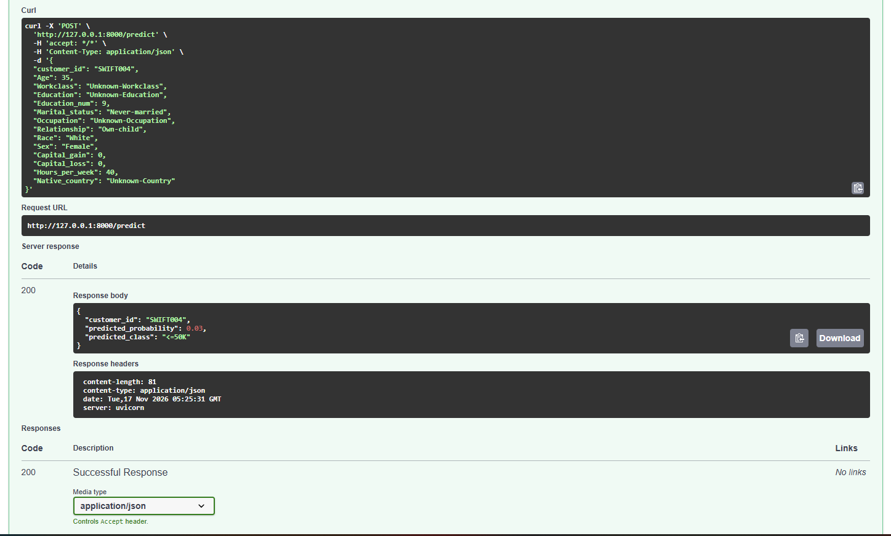
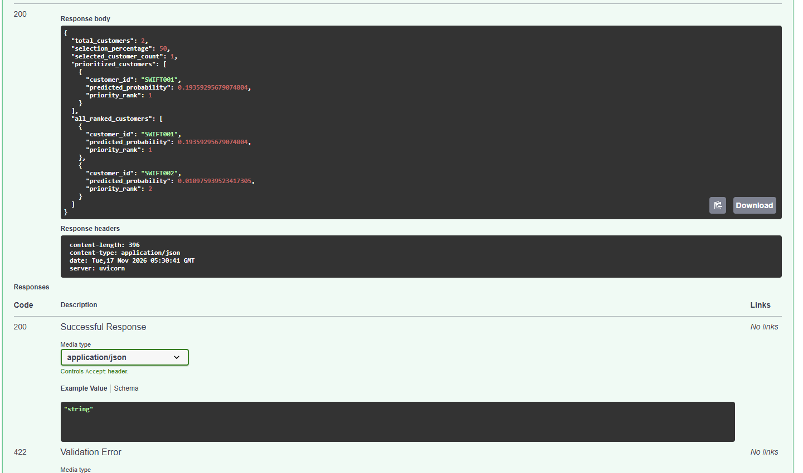
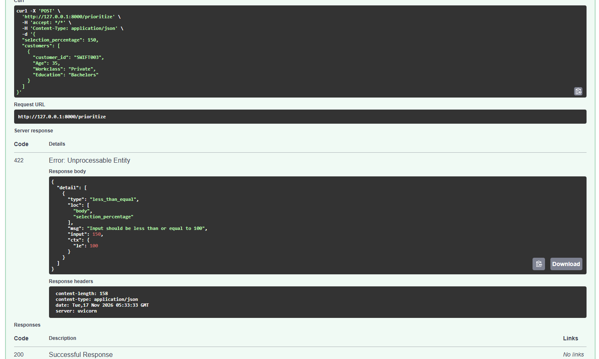

# SwiftShip Logistics – Customer Intelligence & Prioritization

## 1. Project Overview

An end-to-end machine learning solution that analyzes customer demographic and financial attributes, predicts income categories, and prioritizes customers using predicted probabilities.

**Selected Model:** Gradient Boosting Classifier  
**Technology:** Python, Pandas, NumPy, Scikit-learn, Matplotlib, Seaborn, FastAPI, Joblib.

**Business Objective:** Demonstrate how machine learning can support customer segmentation and prioritization.

**Important:** The supplied dataset contains census income information, not actual SwiftShip logistics transactions. Income is used as a proxy for this assessment and does not represent shipping frequency, loyalty, revenue, or profitability.

## 2. Data Preprocessing and Methodology

**Datasets:** `Census_income_train.csv` and `Census_income_test.csv`.

**Target:** `Income` (`<=50K` = 0, `>50K` = 1).

Preprocessing steps:
- Inspected data types, distributions, missing values, and duplicates.
- Removed duplicate records and replaced `?` markers with missing values.
- Excluded `fnlwgt` from model features because it represents a census sampling weight.
- Applied median imputation and standardization to numerical features.
- Applied most-frequent imputation and one-hot encoding to categorical features.
- Used a stratified 80:20 training-validation split.

### Model Comparison

Three classification algorithms were evaluated on the validation dataset.

| Model | Accuracy | Precision | Recall | F1 Score | ROC-AUC |
|---|---:|---:|---:|---:|---:|
| Gradient Boosting | 87.34% | 79.95% | 63.33% | 70.68% | 92.76% |
| Random Forest | 86.94% | 81.00% | 59.82% | 68.82% | 92.19% |
| Logistic Regression | 85.66% | 74.29% | 61.93% | 67.55% | 90.99% |

Gradient Boosting was selected for the final solution based on its overall performance in the model comparison.

### Final Model Evaluation

A subsequent evaluation and fairness experiment reported the following baseline results:

| Metric | Score |
|---|---:|
| Accuracy | 87.48% |
| Precision | 80.29% |
| Recall | 63.65% |
| F1 Score | 71.01% |
| ROC-AUC | 93.13% |

The 87.34% and 87.48% accuracy results come from separate evaluation stages in the notebook and should not be treated as the same experiment.

## 3. Customer Prioritization

Customers are ranked in descending order of their predicted probability of belonging to the `>50K` income category. The top 20% are selected.

**Validation prioritization results:**

| Metric | Result |
|---|---:|
| Validation customers | 6,508 |
| Top 20% selected | 1,302 |
| Positive customers selected | 1,023 |
| Precision@20% | 78.57% |
| Recall@20% | 65.24% |
| Lift@20% | 3.26 |

The model was also applied to the test dataset:

- Total customers ranked: 16,276
- Top 20% selected: 3,256

**Generated CSV files:**
- `outputs/all_customer_rankings.csv`
- `outputs/top_20_percent_customers.csv`

**Test limitation:** The supplied test file has no usable `Income` labels. Therefore, supervised test metrics cannot be calculated. Test results are provided as predictions and rankings only.

**Validation limitation:** The dataset has no date or time column. Time-based splitting, backtesting, time-series plots, and forecasting metrics such as MAE and RMSE are therefore not applicable. A stratified classification validation strategy was used instead.

## 4. Fairness Analysis

Three Gradient Boosting variants were compared by excluding protected or related attributes.

| Model | Accuracy | ROC-AUC |
|---|---:|---:|
| Baseline | 87.48% | 93.13% |
| Without Race and Sex | 87.29% | 92.66% |
| Without Race, Sex and Relationship | 87.14% | 92.53% |

Removing protected attributes did not eliminate subgroup selection-rate disparities. Removing these attributes alone does not guarantee fairness. Further fairness evaluation, mitigation, and legal and ethical review would be required before real-world use.

## 5. API Deployment – FastAPI

The trained model is integrated into a REST API.

| Method | Endpoint | Purpose |
|---|---|---|
| GET | `/` | API welcome endpoint |
| GET | `/health` | API and model health check |
| POST | `/predict` | Individual customer prediction |
| POST | `/prioritize` | Batch customer ranking and prioritization |

API features include probability-based predictions, configurable selection percentage, duplicate ID validation, input validation, missing-value handling, and unseen-category handling.

### API Test Screenshots

**Health Check**


**Individual Customer Prediction**



**Customer Prioritization**



**Input Validation Error**



## 6. Reproducibility and Setup

**Requirements:** Python and pip.

Clone the repository:

```bash
git clone https://github.com/dayaram77/DF-Analytics-2026-Assessment-SableDayaram.git
cd DF-Analytics-2026-Assessment-SableDayaram
```

Create and activate a virtual environment:

```bash
python -m venv .venv
```

Windows:

```powershell
.venv\Scripts\activate
```

Install dependencies:

```bash
pip install -r requirements.txt
```

### Dataset Setup

Place the supplied assessment CSV files in:

```text
data/raw/
├── Census_income_train.csv
└── Census_income_test.csv
```

The assessment datasets are not included in the public repository.

### Run the Jupyter Notebook

```bash
jupyter notebook
```

Open `notebooks/SwiftShip_Customer_Intelligence.ipynb` and execute all cells from beginning to end.

### Run the FastAPI Application

```bash
uvicorn api.main:app --reload
```

- Swagger documentation: http://127.0.0.1:8000/docs
- Health check: http://127.0.0.1:8000/health

The trained model is stored at `models/gradient_boosting_pipeline.pkl`.

## 7. Project Structure

```text
├── api/
│   └── main.py
├── data/
│   └── raw/                 # Supplied datasets (not committed)
├── models/
│   └── gradient_boosting_pipeline.pkl
├── notebooks/
│   └── SwiftShip_Customer_Intelligence.ipynb
├── outputs/
│   ├── all_customer_rankings.csv
│   └── top_20_percent_customers.csv
├── screenshots/
├── requirements.txt
├── README.md
└── .gitignore
```

## 8. Conclusion

This project demonstrates an end-to-end machine learning workflow covering data preprocessing, exploratory analysis, model comparison, customer prioritization, fairness analysis, and REST API deployment.

The Gradient Boosting model achieved 87.48% accuracy in the subsequent evaluation, while the top 20% validation group achieved 78.57% precision.

The solution is an assessment demonstration using census data. Actual SwiftShip logistics customer data and further business validation would be necessary before operational deployment.

**Author:** Sable Dayaram  
**GitHub:** [dayaram77](https://github.com/dayaram77)
