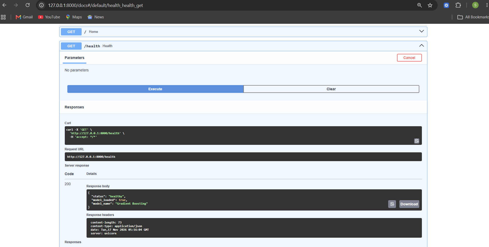
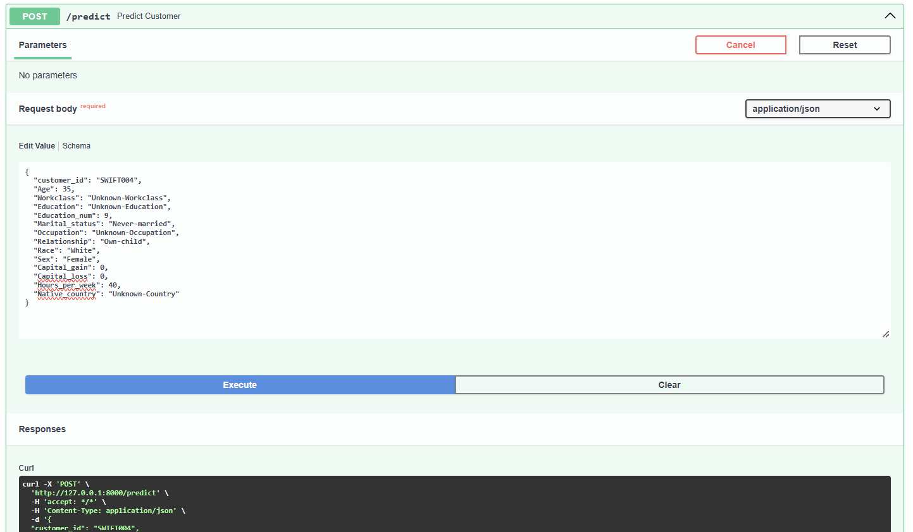
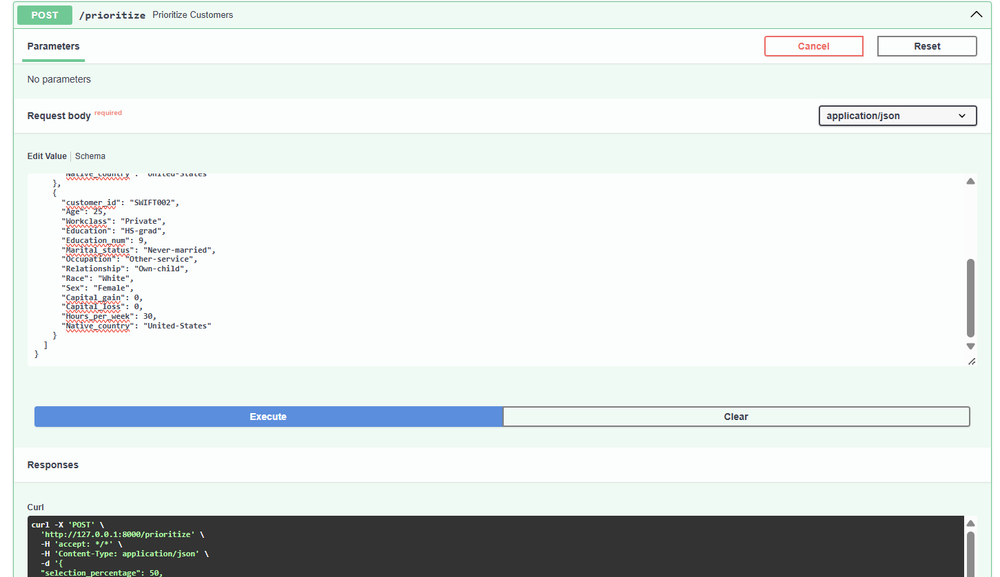
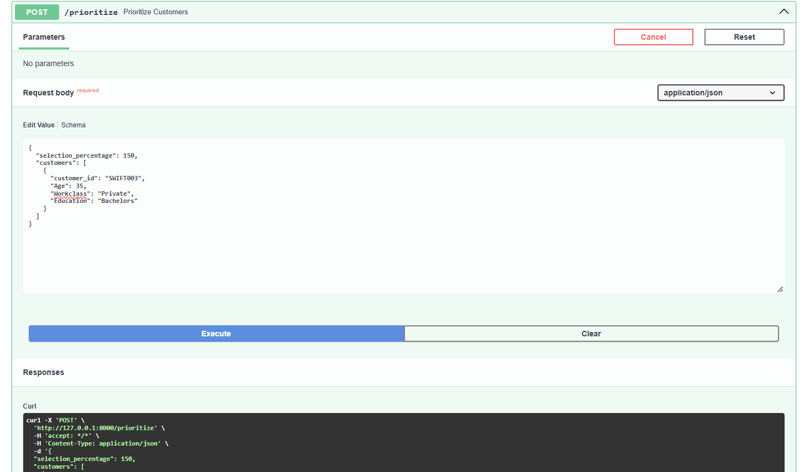

# SwiftShip Logistics – Customer Intelligence & Prioritization

## 1. Project Overview

An end-to-end machine learning solution that analyzes customer demographic and financial attributes, predicts income categories, and ranks customers by their predicted probability of belonging to the `>50K` income group.

**Selected model:** Gradient Boosting Classifier  
**Tech stack:** Python, Pandas, NumPy, Scikit-learn, Matplotlib, Seaborn, FastAPI, Joblib.

**Business objective:** Demonstrate how predictive modeling can support customer segmentation and prioritization.

**Important limitation:** The dataset contains census income information, not SwiftShip logistics transactions. Income is used only as a proxy; predictions do not represent actual shipping frequency, loyalty, revenue, or profitability.

## 2. Data and Methodology

**Datasets:** `Census_income_train.csv` and `Census_income_test.csv`.

**Target:** `Income` (`<=50K` = 0, `>50K` = 1).

Preprocessing included:
- Duplicate removal and replacement of `?` markers with missing values.
- Exclusion of `fnlwgt` from model features.
- Median imputation and scaling for numerical features.
- Most-frequent imputation and one-hot encoding for categorical features.
- Stratified 80:20 train-validation split.

Three algorithms were evaluated: Logistic Regression, Random Forest, and Gradient Boosting. Gradient Boosting was selected for the final model.

### Selected model – validation performance

| Metric | Score |
|---|---:|
| Accuracy | 87.48% |
| Precision | 80.29% |
| Recall | 63.65% |
| F1 Score | 71.01% |
| ROC-AUC | 93.13% |

### Customer prioritization

Customers are ranked by predicted probability. The top 20% are selected.

| Validation metric | Result |
|---|---:|
| Customers evaluated | 6,508 |
| Customers selected | 1,302 |
| Positive customers selected | 1,023 |
| Precision@20% | 78.57% |
| Recall@20% | 65.24% |
| Lift@20% | 3.26 |

The model was applied to 16,276 test records, selecting 3,256 for the top 20% group.

**Generated outputs:**
- `outputs/all_customer_rankings.csv`
- `outputs/top_20_percent_customers.csv`

### Dataset limitations

The supplied test dataset has no usable `Income` labels. Therefore, supervised test metrics cannot be calculated. Test predictions are provided as rankings only.

The dataset has no date or time column, so time-based validation, backtesting, and time-series forecasting metrics are not applicable. A stratified validation strategy and classification metrics were used instead.

## 3. Fairness Analysis

Three Gradient Boosting variants were compared by excluding protected or related attributes.

| Model | Accuracy | ROC-AUC |
|---|---:|---:|
| Baseline | 87.48% | 93.13% |
| Without Race and Sex | 87.29% | 92.66% |
| Without Race, Sex and Relationship | 87.14% | 92.53% |

Removing protected attributes did not eliminate subgroup selection-rate disparities. This analysis does not establish fairness or suitability for real-world targeting. Further evaluation and legal and ethical review would be required.

## 4. Reproducibility and Setup

**Requirements:** Python and pip.

Clone the repository:

```bash
git clone https://github.com/dayaram77/DF-Analytics-2026-Assessment-SableDayaram.git
cd DF-Analytics-2026-Assessment-SableDayaram
```

Create and activate a virtual environment:

```bash
python -m venv .venv
```

Windows:

```powershell
.venv\Scripts\activate
```

Install dependencies:

```bash
pip install -r requirements.txt
```

Place the two supplied CSV files in the data location expected by the notebook. The assessment datasets are not included in this repository.

**Run the notebook:** Open Jupyter Notebook, navigate to `notebooks/SwiftShip_Customer_Intelligence.ipynb`, and execute all cells from top to bottom.

```bash
jupyter notebook
```

**Run the API:**

```bash
uvicorn api.main:app --reload
```

API documentation: http://127.0.0.1:8000/docs  
Health check: http://127.0.0.1:8000/health

The trained model is stored at `models/gradient_boosting_pipeline.pkl`.

## 5. API Screenshots

The API was tested for health checks, individual predictions, batch prioritization, and input validation.

**Health check**



**Individual prediction**



**Customer prioritization**



**Validation error**



## 6. Project Structure

```text
├── api/
│   └── main.py
├── data/
├── models/
│   └── gradient_boosting_pipeline.pkl
├── notebooks/
│   └── SwiftShip_Customer_Intelligence.ipynb
├── outputs/
│   ├── all_customer_rankings.csv
│   └── top_20_percent_customers.csv
├── screenshots/
├── requirements.txt
├── README.md
└── .gitignore
```

## 7. Conclusion

The project demonstrates data preprocessing, exploratory analysis, classification model development, evaluation, customer prioritization, fairness analysis, and REST API deployment.

The Gradient Boosting model achieved 87.48% validation accuracy and 93.13% ROC-AUC. The top 20% validation group achieved 78.57% precision.

This is an assessment demonstration using census data. Actual SwiftShip customer data and further business validation would be necessary before operational use.

**Author:** Sable Dayaram  
**GitHub:** https://github.com/dayaram77
